# Voltímetro Digital

## Integrantes
* **Angye Valentina García Páramo**
* **Samuel Esteban Quesada Portela**

---
**Informe Técnico Completo:** Consulta la memoria detallada de diseño, cálculos y análisis de resultados en [`docs/Voltimetro_ELDI_Proyecto_Final.pdf`](docs/Voltimetro_ELDI_Proyecto_Final.pdf).

## Resumen

Este repositorio contiene el diseño, simulación e implementación física de un voltímetro digital desarrollado como proyecto final para la asignatura **Electrónica Digital (ELDI)** durante el periodo académico **2026-2** en la **Escuela Colombiana de Ingeniería Julio Garavito**. El instrumento opera bajo una arquitectura de Convertidor Analógico-Digital por Aproximaciones Sucesivas (**SAR ADC**) de 10 bits implementada en Verilog sobre una tarjeta de desarrollo **Digilent Basys 3**, acoplada a una etapa analógica externa compuesta por una red escalera R-2R, un amplificador operacional LM358 y un comparador LM393. Todo el sistema digital fue construido bajo un enfoque estructural y deconstruido (tablas de verdad, ecuaciones booleanas, compuertas lógicas y flip-flops), incorporando visualización en tres displays de 7 segmentos externos, función de retención de lectura y cambio automático de escala entre milivoltios y voltios.

---

## Especificaciones Técnicas

| Parámetro | Especificación | Detalle de Implementación |
| :--- | :--- | :--- |
| **Rango de medición** | $0.00\text{ V} - 5.00\text{ V}$ DC | Escala completa mediante acondicionamiento analógico |
| **Resolución** | $\approx 4.88\text{ mV}$ ($1\text{ LSB}$) | $V_{FS} / 2^{10} = 5.00\text{ V} / 1024$ (10 bits) |
| **Frecuencia de operación** | $1\text{ kHz}$ | Divisor de frecuencia desde el reloj base de $100\text{ MHz}$ |
| **Sistema de Auto-Rango** | Cambio automático en $1.00\text{ V}$ | Umbral digital `10'b0011001100` (decimal `204`) |
| **Indicador de Escala** | LED `LD15` (`PUNTO`) | Encendido (`1`): Voltios ($V$) \| Apagado (`0`): Milivoltios ($mV$) |
| **Función Pausa** | Interruptor `Sw1` | Congela la lectura actual sin detener la conversión interna |
| **Visualización** | 3 Displays 7 Segmentos externos | Cátodo común conectados vía puertos PMOD (`JXADC`, `JA`, `JC`) |

---

## Arquitectura del Sistema

El sistema se divide en tres etapas fundamentales: acondicionamiento y conversión analógica externa, procesamiento digital y control SAR dentro de la FPGA, y visualización por escala.

### 1. Sistema Físico y Frontera Analógica-Digital
* **DAC Externo (Red Escalera R-2R + LM358):** Es una red resistiva de 10 ramas ponderadas binariamente (donde cada bit $b_i$ aporta un peso proporcional a $2^i / 2^{10}$) que convierte la palabra digital `R_2R[9:0]` proveniente de los pines de $3.3\text{ V}$ de la FPGA en un voltaje analógico equivalente:
  $$V_{R\text{-}2R} = 3.3\text{ V} \cdot \sum_{i=0}^{9} \frac{b_i}{2^{10-i}}$$
  Esta señal pasa por un amplificador operacional **LM358** en configuración no inversora ($G = 1 + \frac{R_f}{R_1} \approx 1.515$) para escalar el rango máximo de $3.3\text{ V}$ a **$5.00\text{ V}$** ($V_{DAC}$) con alimentación única positiva.
* **Comparador Analógico (LM393):** Compara en cada ciclo el voltaje desconocido de entrada ($V_{in}$) contra el voltaje generado por el DAC ($V_{DAC}$). Su salida en colector abierto con resistencia *pull-up* a $3.3\text{ V}$ entrega el bit de decisión `C` hacia la FPGA (`C = 1` si $V_{in} > V_{DAC}$, o `C = 0` si $V_{in} < V_{DAC}$).
* **Algoritmo de Aproximaciones Sucesivas (SAR):** Para determinar el valor digital de $V_{in}$, la FPGA ejecuta una búsqueda binaria en **10 pasos** (desde el bit más significativo `R_2R[9]` hasta el menos significativo `R_2R[0]`):
  1. Activa temporalmente el bit en turno en `'1'` (empezando por `10'b1000000000`, equivalente a mitad de escala: $2.50\text{ V}$) manteniendo los demás en `'0'`.
  2. Evalúa la respuesta del comparador (`C`): si $V_{in} > V_{DAC}$ (`C = 1`), conserva ese bit en `'1'` porque el voltaje real es mayor; de lo contrario (`C = 0`), lo descarta regresándolo a `'0'`.
  3. Repite el proceso bit a bit hasta converger en 10 ciclos a la palabra digital de 10 bits más cercana a $V_{in}$ con un error máximo de $\pm 1\text{ LSB}$ ($\approx 4.88\text{ mV}$), momento en el cual habilita `WE` para actualizar la lectura en los displays.


---

### 2. Arquitectura General RTL (`Modulo_Principal`)
La lógica digital se construyó de manera modular y jerárquica:

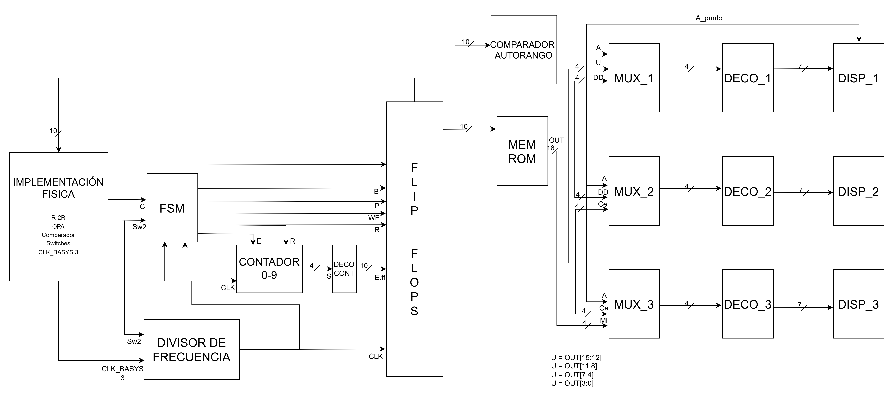

* **Divisor de Frecuencia (`Divisor_Frecuencia` / `Clk`):** Reduce el reloj maestro de $100\text{ MHz}$ (`clk_Basys`) a la frecuencia de operación de $1\text{ kHz}$ mediante un contador de 11 bits (`0` a `1249`) y conmutación por Flip-Flop tipo T.
* **Máquina de Estados Finitos (`FSM`):** Controlador tipo Moore diseñado mediante ecuaciones de estado siguiente y salida por mintérminos. Coordina el reinicio (`R`), habilitación de conteo (`E`), prueba de bits (`B`), retención de bits (`P`) y escritura final (`WE`).
* **Contador de Ciclos (`contador_FSM_`) y Decodificador (`DECO_CONT`):** Contador síncrono de módulo 10 (`S[3:0]`) acoplado a un decodificador *one-hot* de 10 bits (`E_ff[9:0]`) que selecciona secuencialmente cada bit desde el MSB (`[9]`) hasta el LSB (`[0]`).
* **Banco de Registros (`Flip_Flops`):** Compuesto por el Registro SAR de 10 bits (que alimenta la red `R_2R` en tiempo real) y el Registro de Salida con retención (`WE` + `Sw1`) que mantiene estable la dirección `Addr[9:0]`.
* **Memoria de Conversión (`mem_rom`):** Memoria ROM de $1024 \times 16$ bits inicializada con `rom_data.mem`, encargada de traducir cada código binario de 10 bits a su representación BCD de 4 dígitos (`U`, `DD`, `Ce`, `Mi`).
* **Comparador de Auto-Rango (`COMPARADOR`):** Evalúa estructuralmente si `Addr > 10'b0011001100` ($1.00\text{ V}$) para generar la señal de selección de escala `A` (`PUNTO`).
* **Multiplexores (`MUX_2x1_4bits`) y Decodificadores (`DECODIFICADOR`):** Seleccionan los 3 dígitos correspondientes según el rango activo (`U.DD.Ce` en voltios o `DD.Ce.Mi` en milivoltios) y los decodifican a 7 segmentos (cátodo común).

---

### 3. Deconstrucción Estructural por Módulo

Cada bloque combinacional y secuencial fue sintetizado a partir de su tabla de verdad, ecuaciones booleanas y esquemáticos a nivel de compuertas lógicas (`AND`, `OR`, `NOT`), sumadores, multiplexores y Flip-Flops:

#### Divisor de Frecuencia (`100 MHz` $\rightarrow$ `1 kHz`)
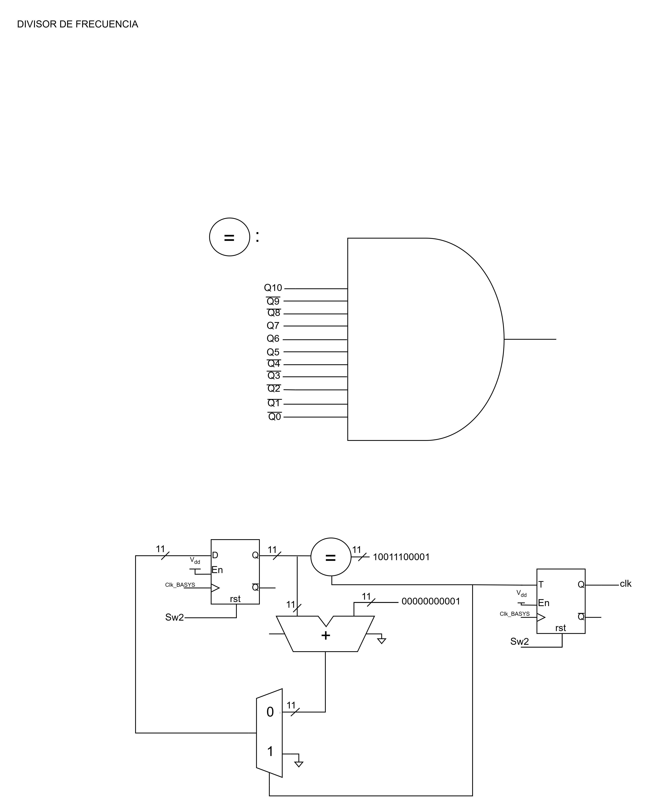

#### Máquina de Estados Finitos (`FSM`)


#### Contador de Ciclos (`0` a `9`) y Decodificador de Habilitación (`DECO_CONT`)
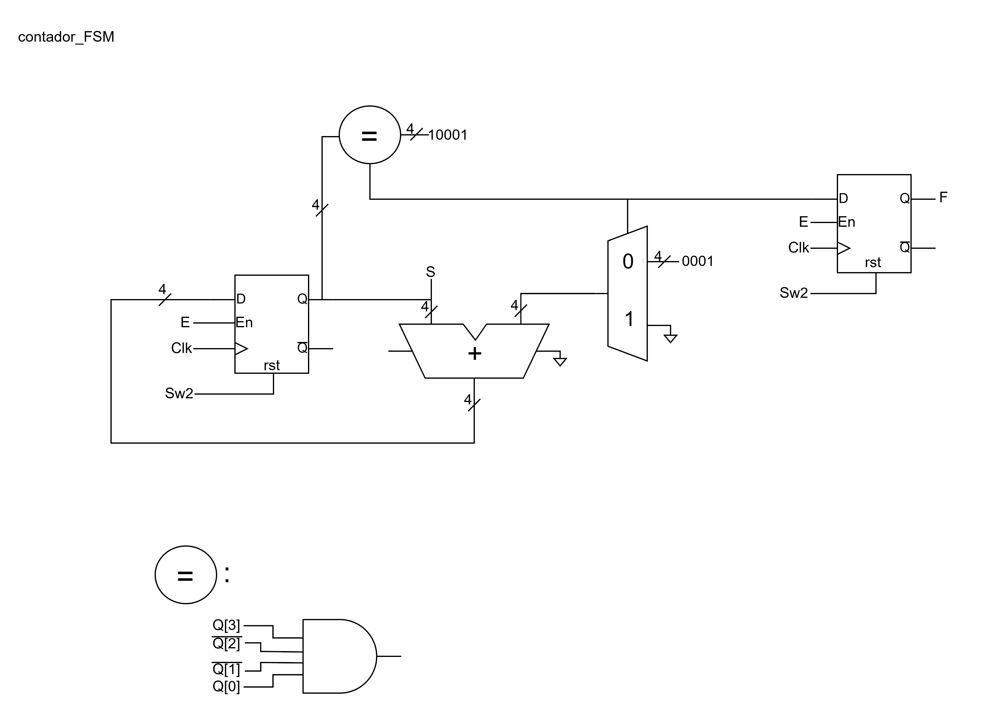
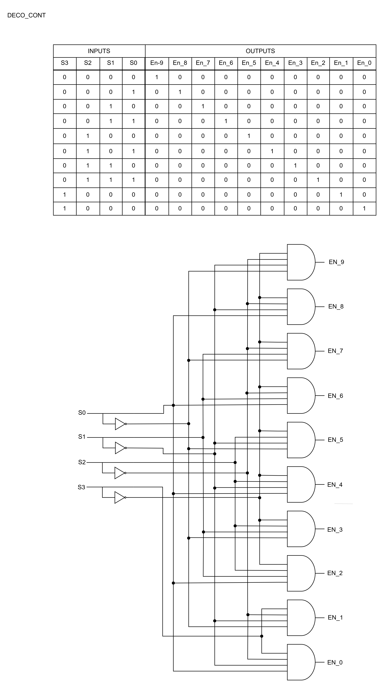

#### Registros SAR y de Retención (`Flip_Flops`)
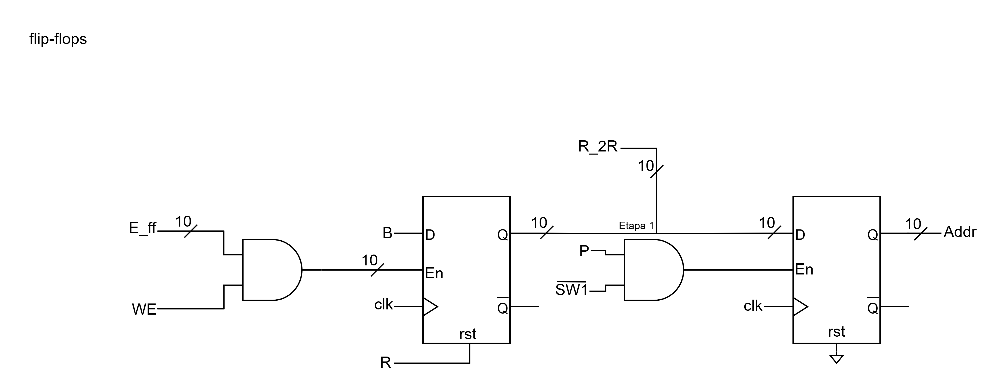

#### Memoria ROM (`1024 x 16 bits`)
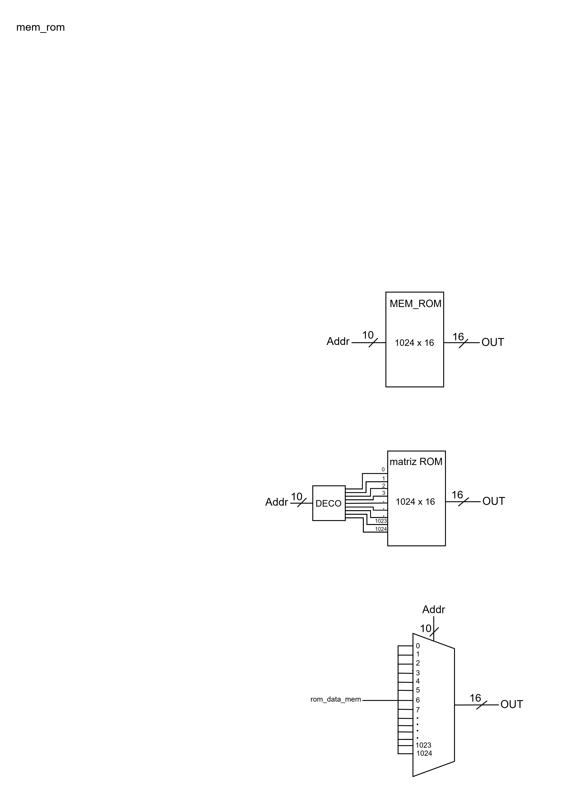

#### Comparador de Umbral de Auto-Rango (`1.00 V`)
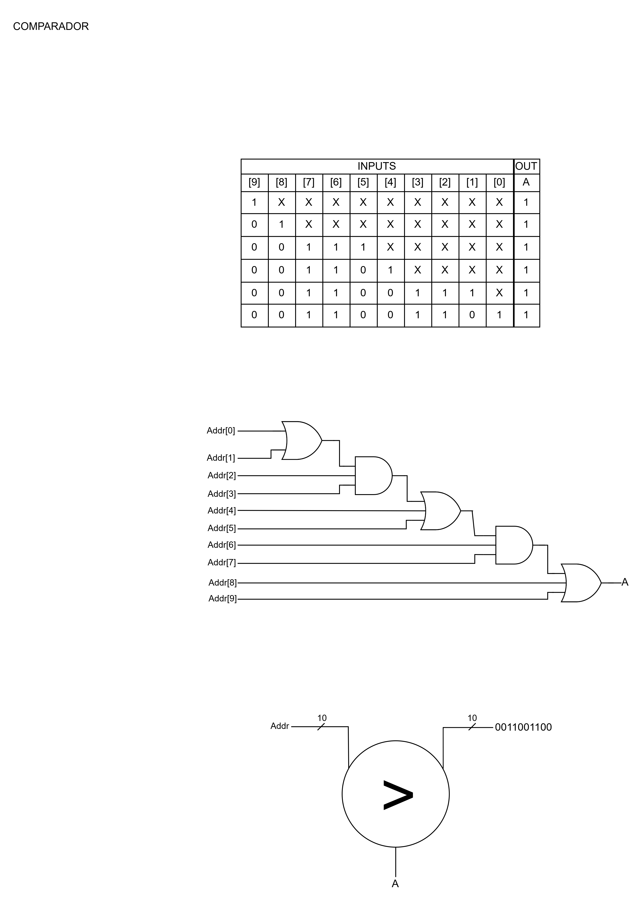

#### Multiplexor 2:1 de 4 Bits (`MUX_2x1_4bits`) y Decodificador BCD a 7 Segmentos (`DECODIFICADOR`)
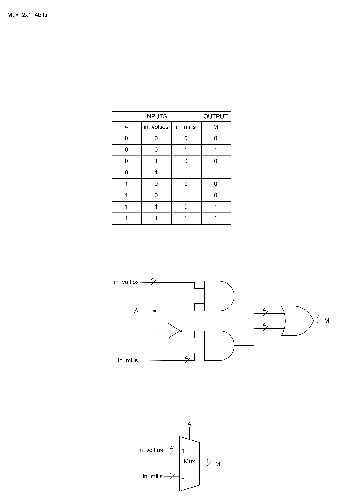
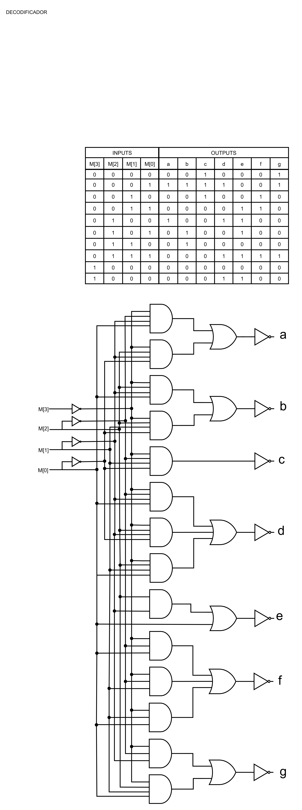

---

## Estructura del Repositorio

## Estructura del Repositorio

```text
├── rtl/                        # Código fuente sintetizable en Verilog
│   ├── CODIGO_PRINCIPAL.v      # Módulo superior (Modulo_Principal)
│   ├── Clk.v                   # Divisor de frecuencia (100 MHz -> 1 kHz)
│   ├── FSM.v                   # Máquina de estados finitos (control SAR)
│   ├── contador_FSM_.v         # Contador de 0 a 9 para barrido de bits
│   ├── DECO_CONT.v             # Decodificador de habilitación de Flip-Flops
│   ├── Flip-Flops.v            # Registros SAR y de retención (Pausa)
│   ├── MEMORIA.v               # Memoria ROM de conversión Binario a BCD
│   ├── rom_data.mem            # Tabla de calibración hexadecimal (1024 posiciones)
│   ├── COMPARADOR.v            # Detector de umbral de auto-rango (1.00 V)
│   ├── MUX_2x1_4bits.v         # Multiplexor estructural de auto-rango
│   └── DECODIFICADOR.v         # Decodificador BCD a 7 segmentos (cátodo común)
├── tb/                         # Bancos de prueba (Testbenches) para simulación
├── constraints/                # Archivo de asignación de pines para Vivado
│   └── constrains.xdc          # Mapeo de puertos PMOD (JXADC, JA, JB, JC), SW y LED
└── docs/                       # Documentación y esquemáticos jerárquicos
    └── Esquematicos/           # Diagramas de bloques y deconstrucción estructural (.png / .webp)
```
## Reproducción del Proyecto

---

## Reproducción del Proyecto

### 1. Requerimientos de Hardware y Hojas de Datos (Datasheets)

Para replicar el montaje físico del voltímetro digital se requieren los siguientes componentes y su documentación técnica de referencia:

| Componente | Cantidad | Descripción / Función | Documentación Técnica |
| :--- | :---: | :--- | :--- |
| **Digilent Basys 3** | 1 | Tarjeta FPGA Xilinx Artix-7 (`xc7a35tcpg236-1`) | [Manual de Referencia Basys 3 (Digilent)](https://digilent.com/reference/programmable-logic/basys-3/reference-manual) |
| **Amplificador Operacional LM358** | 1 | Etapa de ganancia no inversora ($G \approx 1.515$) para escalar $3.3\text{ V} \rightarrow 5.0\text{ V}$ | [Datasheet LM358 (Texas Instruments)](https://www.ti.com/lit/ds/symlink/lm358.pdf) |
| **Comparador de Voltaje LM393** | 1 | Comparador analógico con salida en colector abierto (requiere *pull-up* a $3.3\text{ V}$) | [Datasheet LM393 (Texas Instruments)](https://www.ti.com/lit/ds/symlink/lm393.pdf) |
| **Red Escalera R-2R y Resistencias** | 1 set | Red R-2R de 10 bits ($R = 10\text{ k}\Omega$, $2R = 20\text{ k}\Omega$), resistencias de $10\text{ k}\Omega$, $4.7\text{ k}\Omega$ y potenciómetro de ajuste | Código de colores estándar ($1\%$ tolerancia recomendada) |
| **Displays 7 Segmentos (Cátodo Común)** | 3 | Visualización de dígitos (el punto decimal de escala se indica en el LED `LD15` de la Basys 3) | [Datasheet Display 7 Segmentos Estándar](https://www.vishay.com/docs/83180/tdcx10x0m.pdf) |
| **Resistencias limitadoras ($220\text{ }\Omega - 330\text{ }\Omega$)** | 21 | Protección de corriente para los 7 segmentos (`a`–`g`) de cada display | — |
| **Fuente DC Regulada ($+12\text{ V}$)** | 1 | Alimentación positiva para el LM358 y el LM393 (evita saturación en el rango de $0\text{ V} - 5\text{ V}$) | — |

---

### 2. Requerimientos de Software y Herramientas

* **Síntesis e Implementación en FPGA:**
  * [AMD / Xilinx Vivado Design Suite](https://www.xilinx.com/support/download.html): Entorno oficial para síntesis, implementación, generación del archivo `.bit` y programación de la Basys 3.
  * [Archivos de Tarjeta Digilent (Board Files)](https://digilent.com/reference/software/vivado/board-files): Paquete de configuración para reconocer la Basys 3 dentro de Vivado.
* **Simulación y Visualización de Ondas:**
  * [Icarus Verilog (`iverilog`)](https://steveicarus.github.io/iverilog/usage/installation.html): Compilador de código abierto para ejecutar los *testbenches* de validación.
  * [GTKWave](https://gtkwave.sourceforge.net/): Visor de formas de onda digitales (`.vcd`) para verificar los 10 ciclos de aproximación sucesiva.
* **Edición y Diagramación:**
  * [Visual Studio Code](https://code.visualstudio.com/) junto con [Draw.io / diagrams.net](https://www.drawio.com/) para la edición del código RTL y los esquemáticos jerárquicos.

---

### 3. Diagrama de Conexiones y Montaje Físico

#### A. Referencia Común (`GND`) y Alimentación
* **Tierra Común (`GND`):** Todas las tierras de la protoboard (cátodos comunes de los 3 displays, rama de tierra de la red R-2R, etapa del LM358, etapa del LM393 y negativo de la fuente de $12\text{ V}$) están interconectadas entre sí y unidas mediante un cable físico al pin **`GND` (Pin 5)** del conector PMOD **`JA`** de la Basys 3.
* **Alimentación Analógica:** Los circuitos integrados **LM358** y **LM393** se alimentan con **$+12\text{ V}$ DC** en su **Pin 8 ($V_{CC}$)**.
* **Referencia Lógica de $3.3\text{ V}$:** Se toma directamente desde el **Pin 6 (`3V3`)** del conector PMOD **`JA`** de la Basys 3.

#### B. Displays de 7 Segmentos (Cátodo Común)
Los puntos decimales físicos (`DP`) de los displays no se utilizan; el indicador de escala en voltios ($V$ / $mV$) se visualiza directamente en el **LED `LD15`** de la Basys 3.

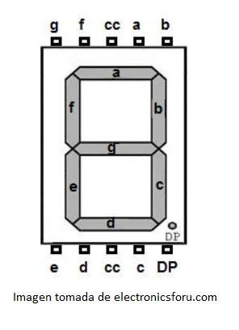

| Display | Conector PMOD Basys 3 | Seg. `a` | Seg. `b` | Seg. `c` | Seg. `d` | Seg. `e` | Seg. `f` | Seg. `g` | Cátodo Común |
| :--- | :---: | :---: | :---: | :---: | :---: | :---: | :---: | :---: | :---: |
| **Display Izquierdo (`Di_1`)** | **`JXADC`** | Pin 1 | Pin 2 | Pin 3 | Pin 4 | Pin 7 | Pin 8 | Pin 9 | `GND` común |
| **Display Central (`Di_2`)** | **`JA`** | Pin 1 | Pin 2 | Pin 3 | Pin 4 | Pin 7 | Pin 8 | Pin 9 | `GND` común |
| **Display Derecho (`Di_3`)** | **`JC`** | Pin 1 | Pin 2 | Pin 3 | Pin 4 | Pin 7 | Pin 8 | Pin 9 | `GND` común |


#### C. Red Escalera R-2R (DAC de 10 Bits)
Cada rama digital de la red escalera se conecta desde el bit más significativo (MSB, ubicado en el extremo más cercano al nodo de salida analógica $V_{R\text{-}2R}$) hasta el bit menos significativo (LSB):

| Bit del Bus `R_2R` | Peso Binario | Conector PMOD Basys 3 | Pin PMOD |
| :--- | :---: | :---: | :---: |
| **`R_2R[9]` (MSB)** | $2^9$ (más cercano a $V_{out}$) | **`JA`** | Pin 10 |
| **`R_2R[8]`** | $2^8$ | **`JB`** | Pin 1 |
| **`R_2R[7]`** | $2^7$ | **`JB`** | Pin 2 |
| **`R_2R[6]`** | $2^6$ | **`JB`** | Pin 3 |
| **`R_2R[5]`** | $2^5$ | **`JB`** | Pin 4 |
| **`R_2R[4]`** | $2^4$ | **`JB`** | Pin 7 |
| **`R_2R[3]`** | $2^3$ | **`JB`** | Pin 8 |
| **`R_2R[2]`** | $2^2$ | **`JB`** | Pin 9 |
| **`R_2R[1]`** | $2^1$ | **`JB`** | Pin 10 |
| **`R_2R[0]` (LSB)** | $2^0$ | **`JC`** | Pin 10 |

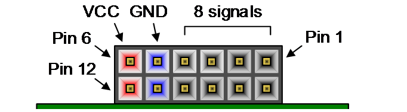

#### D. Amplificador Operacional LM358 (Acondicionamiento $3.3\text{ V} \rightarrow 5.0\text{ V}$)
Configurado como amplificador no inversor de ganancia ajustable mediante el primer canal (pines 1–3), dejando el segundo canal en estado seguro a tierra:

| Pin LM358 | Nombre | Conexión en el Circuito |
| :--- | :--- | :--- |
| **Pin 1** | `OUT 1` | Conectado al **Pin 2 (`IN 1-`) del comparador LM393** y a una resistencia de **$4.7\text{ k}\Omega$** en serie con un potenciómetro de realimentación hacia el **Pin 2** del LM358. |
| **Pin 2** | `IN 1-` | Conectado a una resistencia de **$10\text{ k}\Omega$ a `GND`** y al extremo del potenciómetro en serie con la resistencia de $4.7\text{ k}\Omega$ proveniente del **Pin 1**. |
| **Pin 3** | `IN 1+` | Conectado directamente al nodo de salida analógica ($V_{R\text{-}2R}$) de la **red escalera R-2R**. |
| **Pin 4** | `GND` | Conectado a **tierra común (`GND`)**. |
| **Pin 5** | `IN 2+` | Conectado a **tierra común (`GND`)** (canal no utilizado). |
| **Pin 6** | `IN 2-` | Unido directamente con el **Pin 7 (`OUT 2`)** en configuración seguidor a tierra. |
| **Pin 7** | `OUT 2` | Unido directamente con el **Pin 6 (`IN 2-`)**. |
| **Pin 8** | `VCC` | Conectado a alimentación positiva de **$+12\text{ V}$ DC**. |

#### E. Comparador Analógico LM393 (Frontera Analógica-Digital)
Configurado mediante su primer comparador (pines 1–3) con resistencia *pull-up* para adaptar la salida a niveles lógicos `LVCMOS33` ($3.3\text{ V}$):

| Pin LM393 | Nombre | Conexión en el Circuito |
| :--- | :--- | :--- |
| **Pin 1** | `OUT 1` | Nodo compartido entre: **(1)** resistencia *pull-up* de **$10\text{ k}\Omega$** conectada al **Pin 6 (`3V3`) del puerto `JA`**, y **(2)** línea de datos `C` hacia el **Pin 10 del puerto `JXADC`** de la Basys 3. |
| **Pin 2** | `IN 1-` | Conectado al **Pin 1 (`OUT 1`) del amplificador LM358** ($V_{DAC}$ escalado de $0\text{ V}$ a $5.0\text{ V}$). |
| **Pin 3** | `IN 1+` | Entrada de medición: recibe el **voltaje desconocido a medir ($V_{in}$)** en el rango de $0\text{ V}$ a $5.0\text{ V}$. |
| **Pin 4** | `GND` | Conectado a **tierra común (`GND`)**. |
| **Pin 5** | `IN 2+` | Conectado a **tierra común (`GND`)** (canal no utilizado). |
| **Pin 6** | `IN 2-` | Conectado a **tierra común (`GND`)** (canal no utilizado). |
| **Pin 7** | `OUT 2` | Sin conexión (**libre** / colector abierto). |
| **Pin 8** | `VCC` | Conectado a alimentación positiva de **$+12\text{ V}$ DC**. |

---

### 4. Controles e Indicadores en la Tarjeta Basys 3

| Elemento en Basys 3 | Señal RTL | Función |
| :--- | :--- | :--- |
| **Switch `SW1`** | `Sw1` | **Pausa / Retención:** En `1` congela el valor mostrado en los displays; en `0` actualiza continuamente. |
| **Switch `SW2`** | `Sw2` | **Reset:** Reinicia el divisor de frecuencia, el contador, la FSM y los registros SAR. |
| **LED `LD15`** | `PUNTO` | **Indicador de Auto-Rango:** Encendido (`1`) indica lectura en **Voltios ($V$)** ($\ge 1.00\text{ V}$); apagado (`0`) indica lectura en **Milivoltios ($mV$)** ($< 1.00\text{ V}$). |

---

### 5. Pasos para Simular e Implementar

#### A. Clonación del Repositorio
```bash
git clone [https://github.com/gangyevalentina-jpg/VOLTIMETRO_ELDI1_PROYECTO_FINAL.git](https://github.com/gangyevalentina-jpg/VOLTIMETRO_ELDI1_PROYECTO_FINAL.git)
cd VOLTIMETRO_ELDI1_PROYECTO_FINAL
```

---

## Resultados de Simulación (GTKWave y Consola)

Para validar el funcionamiento integral del voltímetro (`test_modulo_general.v`), se simuló una entrada analógica de **$2.30\text{ V}$** (`codigo_objetivo = 10'b0111010111` / decimal `471`), verificando tanto la convergencia del algoritmo SAR en las formas de onda como la decodificación final hacia los displays de 7 segmentos[cite: 14, 15].

### A. Convergencia SAR en GTKWave
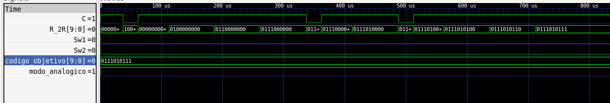

* **Búsqueda Binaria (`R_2R[9:0]`):** El registro SAR evalúa secuencialmente cada bit desde el MSB hasta el LSB (`0100000000` $\rightarrow$ `0110000000` $\rightarrow$ `0111000000` $\rightarrow$ `0111010000` $\rightarrow$ `0111010100` $\rightarrow$ `0111010110` $\rightarrow$ `0111010111`)[cite: 14].
* **Decisión del Comparador (`C`):** Cada vez que la aproximación supera el voltaje de entrada (`1000000000` en $\approx 50\text{ }\mu\text{s}$, `0111100000` en $\approx 350\text{ }\mu\text{s}$ y `0111011000` en $\approx 500\text{ }\mu\text{s}$), la señal `C` conmuta a `'0'` y la FSM descarta dicho bit en el siguiente ciclo; cuando $V_{DAC} \le V_{in}$ (`C = 1`), el bit queda retenido hasta converger al valor esperado (`0111010111`)[cite: 14].

### B. Salida Decodificada y Auto-Rango (`2.30 V`)
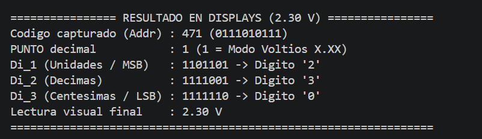

* **Captura en Memoria (`Addr`):** Al finalizar los 10 ciclos, el registro de retención captura el código `471` (`0111010111`)[cite: 15].
* **Selección de Escala (`PUNTO`):** Dado que `471 > 204` ($1.00\text{ V}$), el comparador de auto-rango activa `PUNTO = 1` (modo voltios `X.XX`)[cite: 15].
* **Decodificación a 7 Segmentos:** La memoria ROM y los decodificadores entregan los patrones correspondientes a los dígitos **`2`** (`Di_1 = 1101101`), **`3`** (`Di_2 = 1111001`) y **`0`** (`Di_3 = 1111110`), formando la lectura visual **`2.30 V`**[cite: 15].